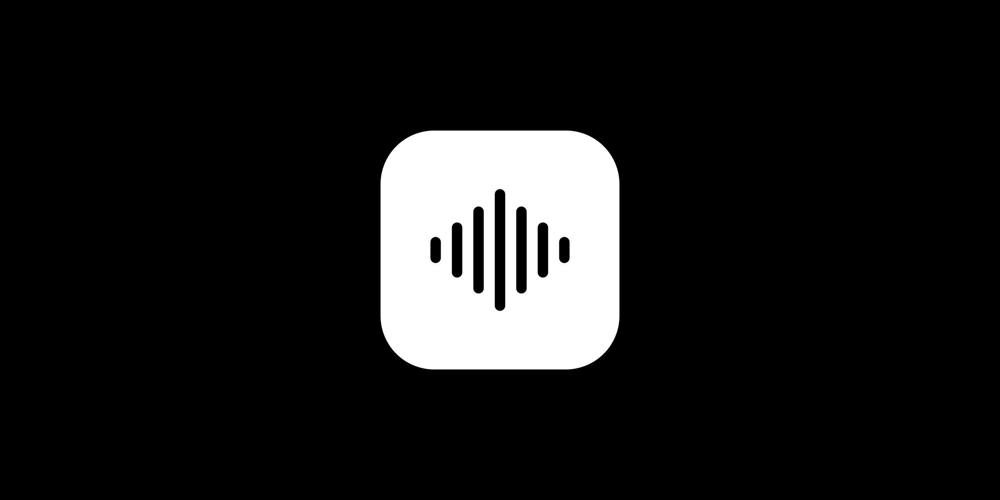

# Open Clone

Clone your voice and make it speak with expression, entirely on your own Mac.

Upload or record one minute of your voice, type some text, pick an expression (Neutral, Happy, Sad, Excited, Angry, Calm) and
Open Clone speaks it in your voice. No account, no cloud: your voice samples and everything you generate stay on your computer.
The only network request the app makes is the one-time download of its models.

## Downloads

| Mac | File |
|---|---|
| Intel | `Open-Clone-<version>-x64.dmg` |
| Apple Silicon (M1 and later) | `Open-Clone-<version>-arm64.dmg` |

Requires macOS 12 or later, 16 GB of memory and about 9 GB of free disk space. On first launch the app downloads its voice
model and a small transcription model (5.4 GB together).

The builds are not yet signed with an Apple Developer ID. To open one, right-click the app and choose Open, then confirm.

**Status of the Apple Silicon build:** it is built and its binaries are verified as `arm64`, but it has not yet been run on an Apple
Silicon Mac. The Intel build is tested end to end.

## Speed

The voice model is large. On Apple Silicon it runs on the Mac's graphics chip; speed there has not been measured yet.

On Intel Macs it runs on the processor and is slow: on a 2017 Intel MacBook Pro (i7-7820HQ) the model takes about a minute to
load, saving a new voice takes about 45 seconds, and each sentence takes 4 to 5 minutes. The app shows the time elapsed and an
estimate while it works. Cancelling stops at once, but the model then has to load again before the next generation.

## Getting a good clone

- A voice needs one full minute of speech. The recorder shows a script to read, coaches you if you are too quiet or too loud,
  and stops by itself when the minute is up. An uploaded file must be at least a minute long.
- Record in a quiet room, close to the microphone, speaking the way you normally do. One speaker only, no music.
- The six expressions work by instruction, with no extra recording. For a stronger effect, open **Expressions** on a voice
  and add a short sample (10 seconds or more) of yourself in that mood: the app then continues from that delivery instead.

The app writes down the words in each sample automatically; the voice model continues from them.

## Saving audio

Each generated clip can be saved as MP3 or WAV from the History list.

## Use it responsibly

Only clone a voice that is yours or that you have permission to clone. The app asks you to confirm this for every voice.

## Build from source

```bash
npm install
npm run dev          # run the app
npm test             # unit tests
npm run dist         # both .dmg files in dist/
```

`npm run dist` first assembles a private Python for each chip in `build/python-<chip>/` (about 1.5 GB each), which the app
carries so that nothing has to be installed by hand. Intel uses PyTorch 2.2.2, the last release with an Intel Mac build.
To run from source, run `npm run runtime:x64` (or `runtime:arm64`) once before `npm run dev`.

## Where your data lives

`~/Library/Application Support/Open Clone/` holds `models/`, `voices/` and `history/`. Delete that folder to remove everything.

## Credits and licence

Open Clone is MIT licensed. Speech is generated by [VoxCPM2](https://github.com/OpenBMB/VoxCPM) from OpenBMB (Apache-2.0),
and samples are transcribed with [Whisper](https://github.com/openai/whisper) through faster-whisper (MIT). See
`THIRD_PARTY_LICENSES.md`.
